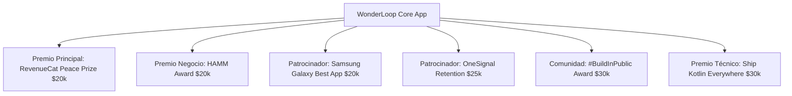

# WonderLoop — Product Requirements Document (PRD)
## RevenueCat Shipaton 2026 Championship Edition

**Documento:** PRD Definitivo para Competición  
**Versión:** 2.0 (Shipaton Edition)  
**Fecha:** Septiembre 2026  
**Fecha Límite Hackathon:** 30 de Septiembre de 2026  
**Objetivo:** Ganar el podio general y maximizar premios de categorías específicas ($700K+ en juego).

---

## 1. Resumen Ejecutivo y Propuesta de Valor (UVP)

### 1.1 El Problema del Mercado
Los padres del siglo XXI enfrentan una crisis sin precedentes: **la sobreexposición infantil a pantallas pasivas y adictivas** (TikTok, YouTube Shorts, juegos hiperestimulantes) que atrofia la imaginación, la paciencia y la motricidad fina.

### 1.2 La Solución: WonderLoop
WonderLoop es la primera plataforma **Phygital (física + digital)** que utiliza la Inteligencia Artificial generativa no para atrapar al niño frente a la pantalla, sino como **un puente para devolverlo al papel**.

1. **Dibuja en papel:** El niño dibuja libremente su personaje con ceras o lápices.
2. **Cobra vida:** La app fotografía el dibujo, interpreta sus colores y rasgos, y genera un libro ilustrado y narrado donde ese dibujo es el héroe indiscutible.
3. **The Creativity Loop (Reto físico):** El cuento nunca termina en la pantalla; concluye con un reto creativo físico (*"Nilo necesita un amigo para cruzar el bosque. ¡Dibújalo en papel para continuar la aventura mañana!"*).

> **Lema de Producto:** *"Every story starts with a drawing. Every story ends with a new one."*

---

## 2. Estrategia Ganadora para RevenueCat Shipaton 2026

Para ganar el hackathon, WonderLoop se estructura en torno a una estrategia de **"Category Stacking" (apilamiento de premios)**:



### 2.1 Mapeo de Categorías y Argumentario para el Jurado

| Categoría | Dotación | Justificación y Ventaja Competitiva de WonderLoop |
| :--- | :--- | :--- |
| **RevenueCat Peace Prize** | **$20,000** | **Objetivo Principal.** Máximo impacto social: combate la adicción digital infantil, fomenta el juego físico y refuerza el vínculo padres-hijos. |
| **HAMM Award (Help Apps Make Money)** | **$20,000** | Estrategia de monetización multi-nivel impecable implementada con RevenueCat: Freemium + Suscripción Familiar + Consumibles ("Spark Packs") + PDF imprimible. |
| **Best App for Galaxy (Samsung)** | **$20,000** | Publicación en Samsung Galaxy Store. Soporte de **S-Pen** (dibujar en Galaxy Tab/Ultra) y **modo plegable** (Galaxy Z Fold como libro abierto). |
| **Keep Them Coming Back (OneSignal)** | **$25,000** | Notificación push diaria orquestada: *"¡Tu personaje Nilo está esperando su nuevo dibujo!"*. Conexión perfecta entre el reto físico y la retención del usuario. |
| **Ship Kotlin Everywhere (JetBrains)** | **$30,000** | Desarrollo en **Kotlin Multiplatform (Compose Multiplatform)** para iOS y Android compartiendo lógica de negocio, UI y el SDK `purchases-kmp`. |
| **#BuildInPublic Award** | **$30,000 (1º)** | Publicación de vídeos de niños alucinando al ver sus dibujos convertidos en libros de cuentos reales. Coeficiente viral máximo. |

---

## 3. Plan Maestro de Publicación en Tiendas (Resolución del Bloqueo Google Play)

### 3.1 La Realidad de Google Play (Cuentas post-noviembre 2023)
Las cuentas personales de Google Play creadas después del 13 de noviembre de 2023 exigen **14 días obligatorios de Closed Testing con 20 testers activos** antes de poder solicitar acceso a producción. Dado el calendario del hackathon (cierre el 30 de septiembre), depender exclusivamente de Google Play supone un riesgo crítico de descalificación.

### 3.2 Solución Estratégica Multi-Tienda (Garantía de Cumplimiento)
Para cumplir al 100% con la regla del Shipaton (*"Must be fully published to App Store, Google Play Store, or Samsung Galaxy Store"*):

1. **Lanzamiento Prioritario 1 — Samsung Galaxy Store (Android):**
   * **CERO requisitos de 20 testers ni periodos de 14 días.** Aprobación estándar en 48-72 horas.
   * Nos habilita automáticamente para competir por los **$20,000** del premio oficial de Samsung.
2. **Lanzamiento Prioritario 2 — Apple App Store (iOS):**
   * Aprobación directa en 24-48 horas. Sin pruebas cerradas obligatorias.
3. **Google Play Store (Paralelo):**
   * Lanzar de inmediato el Closed Track con 20 testers (vía comunidad Discord de Shipaton / contactos) para intentar acelerar producción, pero con Galaxy Store y Apple App Store asegurando la elegibilidad oficial desde el primer momento.

---

## 4. Arquitectura del Sistema y Pipeline de IA

La arquitectura está completamente desacoplada mediante un **Backend Serverless Gateway**, garantizando que las API keys jamás se expongan en el cliente móvil y permitiendo intercambiar proveedores de IA en segundos mediante variables de entorno.

```text
[ Cliente Móvil: Compose Multiplatform (Android/iOS) ]
          │  ▲
          │  │ HTTPS (JWT + Parental Gate)
          ▼  │
[ Backend Gateway: Node.js / FastAPI ]
   ├── RevenueCat Webhook & Entitlement Verification
   ├── Orchestrator / Prompt Manager
   │
   ├── [Vision & Story Adapter] ──► Google Gemini 3.8 Flash (Multimodal)
   ├── [Image Generation Adapter] ──► Nanobanana / Imagen 3 / Flux API
   └── [Speech Synthesis Adapter] ──► Gemini 3.1 TTS / Native Audio
```

### 4.1 Pipeline de Generación por Capas (Decoupled Adapters)

#### Capa 1: Visión y Comprensión del Personaje (Gemini 3.8 Flash)
* **Input:** Imagen capturada del dibujo físico.
* **Prompt del Sistema:** Extracción de metadatos estructurados en JSON:
  * `character_name`: Nombre asignado o sugerido.
  * `species_or_type`: (ej. Dragón, monstruo amable, robot, gato con alas).
  * `primary_colors`: Paleta extraída del dibujo.
  * `distinctive_features`: Ojos grandes, cola de fuego, sombrero pirata, capa azul.
  * `core_emotion`: Alegre, tímido, travieso.

#### Capa 2: Narrativa Estructurada y Consistencia (Gemini 3.8 Flash)
* **Input:** Metadatos del personaje + Perfil del niño (edad) + Semilla temática.
* **Output:** JSON estructurado con 5 escenas (páginas del libro):
  * `page_number`: 1 a 5.
  * `text_content`: Narración adaptada a la edad (4-6 años: frases cortas y rimadas; 7-10 años: misterio y vocabulario enriquecido).
  * `visual_prompt`: Prompt optimizado para la generación de imagen manteniendo los rasgos de Capa 1.
  * `creative_challenge`: El reto físico final para la página 5.

#### Capa 3: Ilustración de Escenas (Nanobanana / Imagen 3)
* Generación de 5 ilustraciones por cuento con estilo visual consistente ("watercolor storybook illustration").
* Inyección del dibujo original en una esquina o como "primer plano de recuerdo" en la portada para evidenciar la transformación mágica.

#### Capa 4: Narración por Voz (Gemini 3.1 TTS)
* Generación de audio cálido y expresivo para cada página, permitiendo al niño seguir la lectura de forma autónoma.

---

## 5. Estrategia y Arquitectura de Monetización (RevenueCat)

La integración con RevenueCat no es un añadido: **es el núcleo del modelo de negocio que evaluará el jurado del premio HAMM**.

### 5.1 Matriz de Planes y Ofertas

| Nivel / Producto | Tipo RevenueCat | Precio Sugerido | Valor y Cuota |
| :--- | :--- | :--- | :--- |
| **Free Explorer** | Freemium | $0 | 1 cuento completo de bienvenida gratis para experimentar el "Momento Mágico". |
| **WonderLoop Single** | Suscripción (Mensual / Anual) | $4.99/mes ó $39.99/año (Free Trial 7 días) | 1 Perfil Infantil. 6 cuentos nuevos al mes. Narración por voz incluida. |
| **WonderLoop Family Multiverse** | Suscripción (Mensual / Anual) | $8.99/mes ó $69.99/año (Free Trial 7 días) | Hasta 3 Perfiles Infantiles. 15 cuentos al mes compartibles. Acceso al "Universo Conectado" (los personajes se conocen entre sí). |
| **Spark Pack (5 Cuentos)** | In-App Purchase (Consumible) | $3.99 | 5 aventuras adicionales cuando se agota la cuota mensual. |
| **Printable Masterpiece PDF** | In-App Purchase (No consumible) | $1.99 / cuento (Gratis para Family) | Exportación en PDF de alta resolución en formato libro A4 listo para imprimir y encuadernar en casa. |

### 5.2 Implementación Técnica con RevenueCat
* **Paywalls Remotos (RevenueCat Paywalls):** Configuración visual desde el dashboard sin requerir actualización en tiendas.
* **Entitlements:**
  * `premium_access`: Habilita la creación de historias según el cupo del plan.
  * `family_sharing`: Habilita múltiples perfiles.
  * `pdf_export`: Acceso ilimitado a exportación imprimible.
* **Acceso del Jurado de Devpost:**
  * Configuración de un **código promocional / bypass** para los jueces (`SHIPATON_JUDGE_VIP`) o activación automática mediante el Sandbox Store de RevenueCat.

### 5.3 Cumplimiento Obligatorio: Kids Category & Parental Gate
Para no ser rechazados por Apple o Google:
* **Parental Gate Obligatorio:** Antes de mostrar cualquier Paywall de RevenueCat o abrir enlaces externos, la app muestra un desafío matemático o de lectura para adultos (*"¿Cuánto es 8 x 7?"* o *"Mantén pulsado durante 3 segundos"*).
* **Cero Publicidad de Terceros:** Cumplimiento estricto de COPPA y RGPD infantil.

---

## 6. Funcionalidades del MVP (Alcance Cerrado para Hackathon)

### 6.1 Módulos P0 (Imprescindibles para Enviar)
1. **Onboarding & Parental Gate:** Registro del padre, creación del perfil infantil (nombre y edad para adaptar vocabulario) y pasarela de control parental.
2. **Scanner Mágico:** Captura con cámara guiada (detección de bordes del papel) o subida desde galería.
3. **El Momento de Transformación:** Animación visual de "analizando la magia del dibujo" (sin pantallas de carga técnicas).
4. **Visor de Libro Digital:**
   * 5 páginas por cuento con ilustración a pantalla completa.
   * Texto con tipografía infantil legible.
   * Botón de reproducción de audio (TTS).
5. **The Creativity Loop (Pantalla Final):** Presentación del reto creativo físico para el día siguiente.
6. **Integración RevenueCat:** Paywall dinámico con suscripciones y verificación de derechos.
7. **Integración OneSignal:** Registro de usuario y trigger de recordatorio push.

### 6.2 Módulos P1 (Diferenciadores de Victoria si el tiempo lo permite)
1. **Soporte Samsung S-Pen:** Lienzo digital integrado para que el niño pueda dibujar con el lápiz directamente en tablets o teléfonos Galaxy Note/Ultra.
2. **Exportador PDF:** Generación de un PDF descargable maquetado con portada, cuento y una lámina en blanco y negro para colorear en papel.
3. **Biblioteca "Mi Universo":** Estantería virtual donde reposan los libros creados.

---

## 7. UX/UI y Especificaciones de Pantalla

### 7.1 Principios de Diseño
* **Aesthetics & Wonder:** Interfaz limpia con tonos cálidos (papel, acuarelas, botones grandes táctiles tipo madera o arcilla). Cero ruido visual ni estética de casino.
* **Dual Interface (Modo Niño vs. Modo Adulto):**
  * *Modo Niño:* Extremadamente visual, sin textos complejos, botones con iconos grandes y feedback sonoro alegre.
  * *Modo Adulto (detrás del Parental Gate):* Gestión de suscripciones RevenueCat, configuración de perfiles y exportación de PDFs.

### 7.2 Flujo Principal de Usuario

```text
[ Home ] ──► "¡Crear una Aventura!" (Botón Gigante)
   │
   ▼
[ Captura de Dibujo ] ──► Guía en pantalla para encuadrar el papel
   │
   ▼
[ Animación Mágica ] ──► "Descubriendo los superpoderes de tu personaje..."
   │
   ▼
[ Lector del Cuento (Páginas 1 a 4) ] ──► Ilustración + Texto + Voz + Pasar Página
   │
   ▼
[ Reto Creativo (Página 5) ] ──► "¡Dibuja un amigo para Nilo!"
   │
   ▼
[ Cierre con OneSignal ] ──► Programa recordatorio para el día siguiente
```

---

## 8. Integración Técnica de Patrocinadores (Código y Configuración)

### 8.1 RevenueCat SDK (`purchases-kmp`)
```kotlin
// Inicialización en Compose Multiplatform
Purchases.configure(
    PurchasesConfiguration.Builder(apiKey = REVENUECAT_API_KEY)
        .appUserID(userId)
        .build()
)

// Comprobación de suscripción antes de generar cuento
fun checkSubscriptionAndCreateStory(onAllowed: () -> Unit, onPaywallRequired: () -> Unit) {
    Purchases.sharedInstance.getCustomerInfo(
        onError = { onPaywallRequired() },
        onSuccess = { customerInfo ->
            if (customerInfo.entitlements["premium_access"]?.isActive == true) {
                onAllowed()
            } else {
                onPaywallRequired()
            }
        }
    )
}
```

### 8.2 OneSignal SDK (Retention Push)
* **Tagging del Usuario:** Al completar una historia, se envía la etiqueta `last_character_name` y `pending_challenge_type`.
* **Campaña de Re-engagement:** Disparo automático tras 20 horas:
  * *Título:* "¡Una carta de [last_character_name]! 💌"
  * *Mensaje:* "Hola, ¡sigo esperando el dibujo de mi nuevo amigo para continuar la aventura! ¿Cogemos los lápices?"

### 8.3 Samsung Galaxy Optimization
* Detección de pantalla plegable (`FoldingFeature`) para adaptar el visor de cuento a doble página en horizontal (como un libro físico desplegado).
* Soporte para eventos de `MotionEvent.TOOL_TYPE_STYLUS` (S-Pen).

---

## 9. Plan de Ejecución en 16 Días (Septiembre 14 - Septiembre 30)

| Fase | Días | Hitos de Entrega |
| :--- | :--- | :--- |
| **Fase 1: Core & Backend** | Días 1 - 4 (14-17 Sep) | • Configurar proyecto KMP / Android.<br>• Implementar backend con adaptadores Gemini (Vision + Story + TTS).<br>• Configurar cuenta de RevenueCat, productos y sandbox. |
| **Fase 2: UI & Flujo Mágico** | Días 5 - 8 (18-21 Sep) | • Desarrollar visor de cuentos y módulo de cámara.<br>• Integrar Paywall de RevenueCat con Parental Gate.<br>• Integrar SDK OneSignal y configurar notificación de prueba. |
| **Fase 3: Envío a Tiendas (CRÍTICO)** | Días 9 - 11 (22-24 Sep) | • **Publicar en Samsung Galaxy Store** (asegura calificación antes del deadline).<br>• Enviar a revisión en **Apple App Store**.<br>• Enviar a Google Play Closed Test. |
| **Fase 4: Marketing y Submisión** | Días 12 - 16 (25-30 Sep) | • Grabar vídeo de demo (< 2 minutos) con un niño real usando la app.<br>• Crear icono 1024x1024 y captura obligatoria (1179x2556px sin marcos).<br>• Publicar posts #Shipaton #BuildInPublic en X y Discord.<br>• Completar formulario de entrega en Devpost. |

---

## 10. Requisitos Obligatorios de Entrega en Devpost

Para evitar cualquier descalificación técnica en la entrega final:
1. **URL de la App en Tienda:** Enlace directo a la app en Samsung Galaxy Store o Apple App Store.
2. **Vídeo de Demostración:** Menor de 2 minutos, alojado en YouTube/Vimeo en modo público, mostrando la app funcionando en un dispositivo real.
3. **Icono y Captura:**
   * Icono: 1024 x 1024 px en PNG.
   * Captura de pantalla: **1179 px de ancho x 2556 px de alto, estrictamente SIN marcos de dispositivo**.
4. **Acceso para Jueces:** Modo de prueba gratuita (Free Trial) activo o código de desbloqueo documentado en las instrucciones de prueba.
5. **Texto de la Presentación:** En inglés, articulando con precisión cómo se usó RevenueCat, OneSignal y la optimización para Samsung.

---

Este documento constituye la especificación funcional y técnica definitiva de WonderLoop para el RevenueCat Shipaton 2026.
